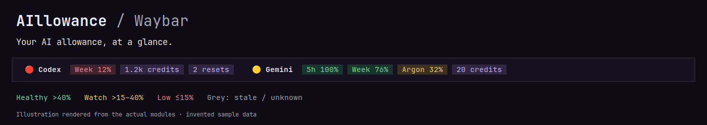
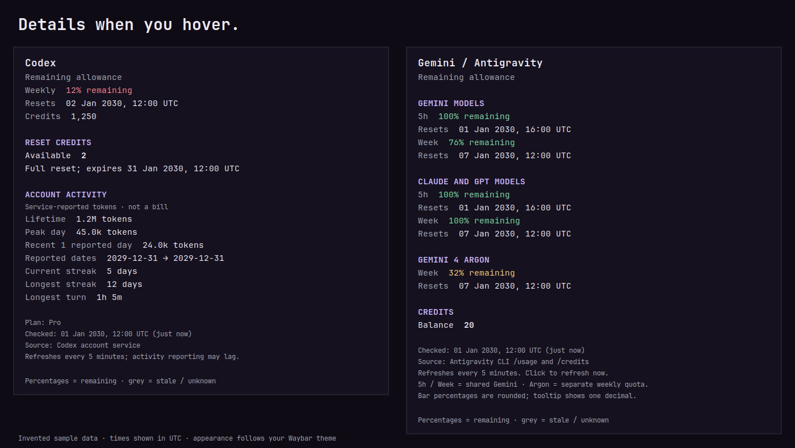

# AIllowance for Waybar

**Your AI allowance, at a glance.** Compact, independently coloured usage chips for **Codex** and **Gemini / Antigravity**, with useful details when you hover.



The images use invented sample data, rendered by the same code as the modules. Actual quotas and available fields depend on your account and CLI version.

## What you get

- One line per service: short-window and weekly allowances when reported, credits, and Codex reset credits.
- Each quota changes colour independently. The service dot follows its lowest displayed quota; uncertain readings use a grey dot.
- Clear tooltips with reset dates, exact balances, model groups, and optional Codex account activity.
- Cached reports, five-minute refreshes, and click-to-refresh on either module.
- Missing data stays unknown. Expired reset times do **not** magically become 100%.
- Install either module or both. No Python packages are required for normal use.



| Colour | Meaning |
| --- | --- |
| Green | More than 40% of an allowance remains |
| Amber | More than 15%, up to 40%, remains |
| Red | 15% or less remains |
| Grey | Stale, missing, or awaiting a new reading after reset |
| Lavender | Positive credits/reset counts; these are counts, not percentages |

Zero credits or reset credits are red. They do not mean the main usage allowance is exhausted. Credits have no reported maximum, so AIllowance does not invent a percentage for them.

## Requirements

- Linux with Waybar, Python **3.10+**, Bash, `jq`, `flock` (usually `util-linux`), and GNU coreutils.
- A monospace font and an emoji font. The example stylesheet prefers JetBrains Mono, Noto Sans, and Noto Color Emoji; alternatives work too.
- **Codex:** an installed, signed-in `codex` CLI whose app-server exposes `account/rateLimits/read`. `account/usage/read` is optional; missing activity does not hide available quotas.
- **Gemini / Antigravity:** a signed-in **`agy` CLI** supporting JSON read-only `/usage` and `/credits` command reports. The version guard requires 1.1.11 or newer; it was tested with 1.5.3. This is **not** an adapter for `gemini` CLI or a scraper for the Antigravity IDE.

The initial release was exercised on Waybar 0.15.0, KDE Plasma / Wayland, Codex CLI 0.167.0, and `agy` 1.5.3. Other compatible versions may work; upstream report formats can change. This project is unofficial and is not affiliated with OpenAI or Google.

On Ubuntu/Debian, install the runtime tools if needed:

```bash
sudo apt install waybar python3 jq util-linux coreutils fonts-noto-color-emoji
```

Install and sign into the provider CLIs separately before enabling their modules. AIllowance does not ask for API keys or handle login for you.

## Install

```bash
git clone https://github.com/vinzify/AIllowance-waybar.git
cd AIllowance-waybar
python3 install.py
```

The installer copies the scripts into `${XDG_CONFIG_HOME:-~/.config}/waybar/aillowance/` and generates a **`modules.json` fragment with your actual paths**. It does not overwrite your Waybar configuration, modify system services, or restart the bar.

1. Merge the two module definitions from the generated `modules.json` into the top-level object in your Waybar config. Keep only the provider you use if you prefer.
2. Add their names to your existing module list, for example:

   ```json
   "modules-right": [
     "custom/codex-usage",
     "custom/antigravity-usage",
     "clock"
   ]
   ```

   Preserve your other modules. Do not create a second `modules-right` key.

3. Optionally merge `examples/style.css` into your Waybar stylesheet. Its module rules affect only AIllowance; its optional `tooltip` rules style **all** Waybar tooltips. Pango markup supplies the individual chip colours without requiring the CSS.
4. Restart Waybar using your desktop's normal launcher or service. No logout or reboot is needed. The first report may take several seconds; hover again after it arrives.

Hover for details. Click either module to request a fresh report. Do not set `escape: true` for these modules: the renderer already escapes external text and deliberately emits Pango markup.

### Alternate locations

```bash
python3 install.py --destination "$HOME/.local/share/aillowance"
```

The generated fragment uses that directory. Provider executables must be visible to **Waybar's environment**, which may differ from an interactive shell.

| Variable | Purpose |
| --- | --- |
| `CODEX_USAGE_CODEX_BIN` | Absolute path to the Codex executable or wrapper |
| `AILLOWANCE_AGY_BIN` | Absolute path to the `agy` executable |
| `XDG_CACHE_HOME` | Base cache directory; defaults to `~/.cache` |
| `CODEX_USAGE_CACHE_FILE` | Optional override for the Codex snapshot file |
| `CODEX_USAGE_STALE_SECONDS` | Codex stale threshold; default `900` seconds |

Set overrides in the environment that launches Waybar or prefix the relevant generated `exec` **and** `on-click` commands with `env VARIABLE=/path/to/executable`. `agy` is discovered on `PATH`, then `~/.local/bin/agy`; Codex also searches installed NVM Node versions as a fallback.

## Reading the details

**Codex:** the bar shows whichever rate-limit windows the account reports; some accounts report only a weekly window. A 5-hour value is not invented when absent. Reset credits are separate from the credit balance. Token totals, streaks, and longest turns are service-reported activity, **not a bill**; the recent-days total covers the latest available reported days and may lag.

**Gemini / Antigravity:** the main bar shows Gemini groups, including a separate Argon quota when reported. Other returned groups, such as Claude/GPT, stay in the tooltip. Their quota windows are not assumed to be interchangeable. Bar percentages are rounded, with tiny nonzero values shown as `<1%`; tooltips show one decimal.

Reset dates use your local timezone. Reports older than 15 minutes turn grey and show a stale notice. A reset time that has passed shows `?` until a fresh report arrives. `~` flags stale data; `!` flags an Antigravity refresh error. The last successful snapshot is retained after a failed fetch.

## Privacy and how it works

- Codex starts a short-lived app-server over stdio and requests account reports. It does not start a conversation, read project files, or scan session logs.
- Antigravity invokes `agy -p /usage --output-format json` and `/credits` in a temporary directory. Only command reports with zero model turns and no conversation ID are accepted. A version guard runs first. Browser-opening helpers are blocked during passive refresh, and automatic CLI updates are disabled for these calls.
- Provider CLIs use your existing sign-in and contact their own services. AIllowance adds no analytics, remote dashboard, or upload endpoint.
- Cached reports live under `~/.cache/aillowance/` (or `XDG_CACHE_HOME`) with owner-only snapshot permissions. They contain **private account balances and usage**; do not publish them. The installer never copies authentication files.
- Upstream CLI behaviour and report schemas remain outside this project's control. An incompatible CLI may leave a module unavailable until the adapter is updated.

## Troubleshooting

**Unknown or stale:** verify the appropriate CLI is signed in, check its path in the desktop environment, then click the module. Quotas may also be unavailable for your account. Do not paste credentials or full account snapshots into an issue.

**Nothing on the bar:** check both the top-level module definition and its name in `modules-right`. Run the generated `exec` command in a terminal; it should emit one JSON object. Inspect Waybar's own logs for config or markup errors.

**Missing emoji:** install an emoji font or change the dots in `scripts/allowance_style.py` to plain circles.

**Different colours/font:** Waybar CSS, font fallbacks, and compositor scaling affect appearance. Start with `examples/style.css`. These are inline highlighted chips; they do not require custom Waybar patches.

## Update or remove

To update, pull this repository and rerun the installer with the same destination. Restart Waybar after changing the scripts. The installer replaces only its own files in that destination; merge any configuration changes yourself.

To uninstall, remove the module entries from your Waybar config, remove the installed `aillowance` directory and any AIllowance CSS you added, then restart Waybar. You may delete `~/.cache/aillowance/` after the modules are disabled. Provider CLIs and their sign-ins are not modified.

## Development

```bash
python3 -m unittest discover -s tests -v
bash -n scripts/codex-usage.sh scripts/codex-usage-refresh.sh
shellcheck scripts/*.sh
```

Tests use invented fixtures and a mock Codex app-server: no login, provider requests, or model calls. CI runs the same checks. See [CONTRIBUTING.md](CONTRIBUTING.md).

To regenerate the documentation images on Debian/Ubuntu:

```bash
sudo apt install python3-gi python3-gi-cairo python3-cairo gir1.2-pango-1.0
/usr/bin/python3 docs/render_previews.py
```

These packages are optional and only needed for image generation.

## License

[MIT](LICENSE) © 2026 vinzify. Contributions welcome.
